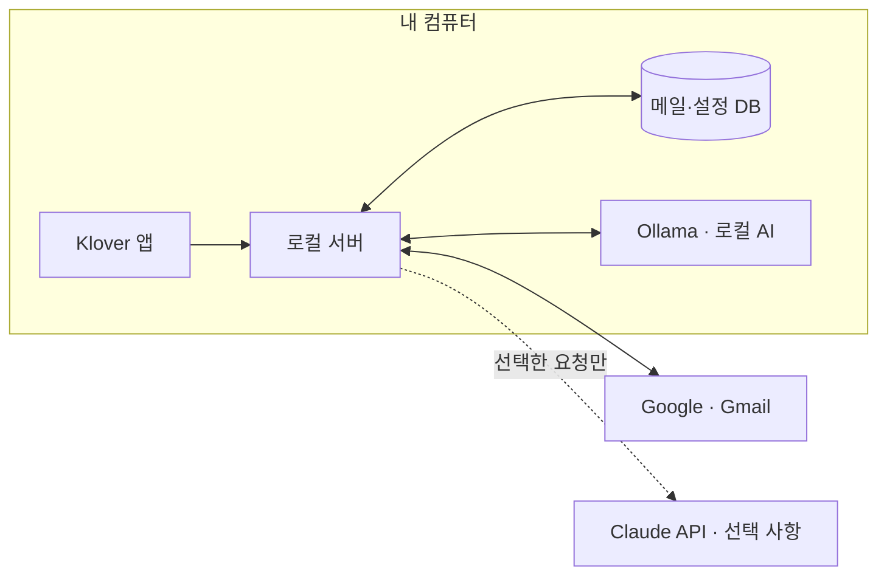

# Klover

Gmail 메일을 읽고, 로컬 AI로 요약·분류·검색하며 답장 초안과 주간 보고서를 만드는 데스크톱 데모입니다.
macOS와 Windows용 실행 경로를 제공합니다. 정식 설치 프로그램은 아직 없습니다.

## 처음 사용하는 동료에게

**[설치·실행 안내 → docs/dev/setup.md](docs/dev/setup.md)**

동료용 설치 기준은 **main**입니다. [저장소 첫 화면](https://github.com/choi7614/klover_my_prototype)의 안내를 따라주세요.
현재 공개 저장소이므로 읽기에는 초대가 필요하지 않습니다. 향후 비공개로 바뀌면 소유자의 초대와 GitHub 인증이 필요합니다.

```bash
git clone --branch main --single-branch https://github.com/choi7614/klover_my_prototype.git
cd klover_my_prototype
```

최초 한 번 Git·Node.js/pnpm·uv·Docker Desktop·Ollama를 설치하고,
본인의 Google 테스트 계정과 웹 OAuth JSON을 준비합니다. 설정은 본인 컴퓨터에서 진행하며 키를 채팅에 보내지 않습니다.
처음에는 로컬 AI만 사용하면 됩니다. Claude는 선택 사항입니다.

## 어떻게 동작하나요?

앱 화면은 같은 컴퓨터의 서버에 요청하고, 서버가 메일·AI·저장을 담당합니다.
동료마다 본인의 PC·Google 계정·DB를 사용하며, 개발자의 서버나 메일을 공유하지 않습니다.



자동 분류·요약·임베딩·할 일 제안은 로컬 AI를 사용합니다. Claude는 동의 후 선택한
초안·검색·보고 요청에만 사용하며 API 요금이 발생할 수 있습니다.
[구성 요소와 데이터 흐름을 쉽게 보기](docs/architecture/overview.md).

## 평소에는 더블클릭

최초 설치와 Google 연결을 마친 뒤 Docker Desktop을 켜고, 저장소 폴더의 파일을 더블클릭하세요.

| OS | 실행 파일 |
| --- | --- |
| macOS | `Klover-Start.command` |
| Windows | `Klover-Start.cmd` |

진행 창에서 DB·로컬 AI·서버를 확인한 뒤 앱을 엽니다. 매번 명령을 입력할 필요는 없습니다.
앱을 종료하면 이번 실행의 서버도 정리합니다. 기존 DB와 이미 켜진 Ollama는 유지됩니다.
[실행 도구의 준비 조건·오류 해결·검증 범위](docs/dev/desktop-launcher.md)를 확인하세요.
**이 파일은 설치용 exe/dmg가 아닙니다.** 처음 도구 설치·모델 다운로드·Google 동의는 필요합니다.

## 사용할 수 있는 기능

- Gmail 받은편지함 목록·본문·수동 새로고침, 기간을 선택한 과거 INBOX 가져오기
- 로컬 AI 요약·분류·요청 추출, 분류 직접 변경, 할 일·일정 제안
- 약어·동의어 확장과 키워드/의미 검색, 근거 메일 확인
- 프로필·문체 설정, 답장 초안 생성·수정·저장
- 첫 주부터 주간 보고 생성·근거 확인·편집·저장·복사
- Calendar 추가 동의와 사용자가 승인한 일정 등록
- 공통 설정과 개인정보·학습 동의/기록 관리

기본 AI와 자동 분석·임베딩은 로컬입니다. 필요한 초안·검색·보고 요청만 Claude를 선택합니다.
Claude 키는 앱 설정에서 입력해 현재 서버에 암호화 저장하며, 외부 전송 동의와 요금 안내가 있습니다.
Claude 구독과 API 요금은 별도입니다. 로컬 전용 모드에서는 Claude 호출을 차단합니다.

아직 없는 기능: 메일 발송·보관·삭제·스팸, 주기 자동 수신, 앱 안 최초 Google 연결 완료,
실제 문체 학습 수집, OS 알림·트레이·시작 프로그램, Word 출력, 설치 파일 배포·자동 업데이트.
학습 동의를 켜도 새 학습 수집이 시작되지는 않습니다. 클라우드 이전은 보류, 사내망 적용은 장기 목표입니다.

## 확인 수준과 데이터 보존

자동 검사는 합성 메일·가짜 AI/Google 응답과 분리 테스트 DB를 사용합니다.
기존 사용자에게 macOS 사용 확인 보고가 있지만, 동료의 새 설치 성공을 보장하지는 않습니다.
Windows 전체 흐름, 실제 모델의 정확도·속도, 실제 Claude 연결은 추가 확인이 필요합니다.

기존 사용자는 재설치 대신 [업데이트](docs/dev/setup.md#9-기존-사용자--업데이트)를 따르세요.
현재 DB head는 `0009_f5_calendar`입니다. DB와 `.env`·`.local-secrets`는 함께 백업하고
메일·토큰·암호화 키를 초기화하거나 공유하지 마세요. 과거 패치는 다시 적용하지 않습니다.

- [문서 지도](docs/README.md): 기능·설계·개발 자료
- [현재 현황](docs/dev/progress.md): 구현·연결·미검증과 작업 이력
- [개발 규칙](AGENTS.md): 브랜치·승인·검사 절차

## 저장소에서 어디를 보면 되나요?

| 찾는 것 | 위치 |
| --- | --- |
| 설치·실행 방법 | [설치 안내](docs/dev/setup.md) |
| 앱·서버 코드와 DB 설정 | [앱·서버](apps/) · [DB 설정](infra/) |
| 구성도·기능·디자인 문서 | [문서 지도](docs/README.md) |
| 테스트와 개발 기록 | [테스트용 예제](fixtures/) · [통합 자료](integration/README.md) · [패치 자료](patches/README.md) |

동료가 설치할 때는 설치 안내만 따라가면 됩니다. 공개된 버전에 반영된 패치를 다시 적용할 필요는 없습니다.

## 출처·저작권·라이선스

설계안 원본은 [와이어프레임](docs/design/mockups/README.md), 로고 등의 출처·사용 규칙은
[브랜드 자료](docs/design/brand/README.md), 앱 브랜드 리소스는 [desktop resources](apps/desktop/resources/README.md)를 보세요.
저장소 전체의 LICENSE 파일은 없습니다. 공개·재배포 이용 조건은 소유자에게 확인하세요.
