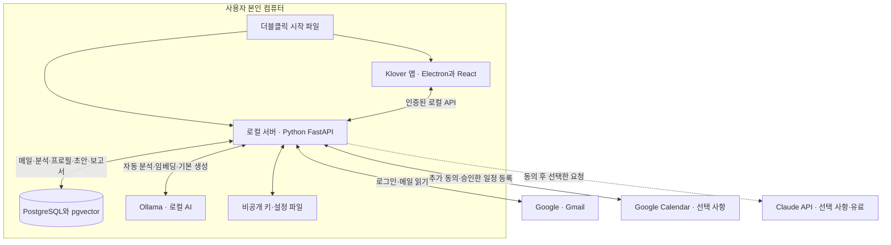

# Klover는 어떻게 동작하나요?

Klover는 **사용자마다 본인 컴퓨터에서 실행하는 메일 도우미**입니다.
GitHub에서는 코드와 안내만 받습니다. 동료들이 하나의 메일함·DB·개발자 서버에 연결하는 구조가 아닙니다.
설치 방법은 [설치·실행 안내](../dev/setup.md)를 따르세요.

## 구성도

| 구성 | 쉬운 설명 | 코드 위치 |
| --- | --- | --- |
| 앱 | 메일을 보고 초안·검색·보고서를 사용하는 화면 | `apps/desktop/` |
| 서버 | 계정 확인, 메일 가져오기, AI 요청, 저장을 담당하는 중간 담당자 | `apps/server/` |
| DB | 받은 메일과 분석 결과·프로필·초안·보고서 등을 보관하는 창고 | `infra/docker-compose.yml`, `apps/server/app/db/` |
| 로컬 AI | 컴퓨터 안에서 분류·요약·임베딩과 기본 생성 처리 | `apps/server/app/ai/` |
| Google 연결 | 사용자가 동의한 Gmail 읽기와 선택적 Calendar 연결 | 서버의 `connectors/`, `services/` |
| Claude 연결 | 선택한 초안·검색·보고 요청을 외부 API로 처리 | 서버의 `ai/selection.py`, `ai/claude.py` |

앱 화면은 제한된 Electron 통신을 거쳐 서버 API만 호출합니다. 화면에서 Gmail·DB·AI에 직접 접근하지 않습니다.

## 메일 한 건이 처리되는 순서

1. 본인 Google 계정으로 로그인하고 Gmail 읽기에 동의합니다. 최초 연결은 설치 안내의 터미널·브라우저 절차입니다.
2. 앱에서 새로고침하면 서버가 사용 시작 이후의 받은편지함 메일을 가져와 중복 없이 DB에 저장합니다.
3. 서버가 뒤에서 로컬 AI로 분류·요약·요청 추출·임베딩을 수행하고 제안과 함께 저장합니다.
4. 앱이 결과를 조회해 메일 목록·본문에 표시합니다. 초안·검색·보고서는 저장한 자료와 프로필을 사용합니다.

과거 메일은 설정에서 기간을 골라 명시적으로 가져와야 합니다. 주기 자동 수신은 아직 없으며 앱 새로고침을 사용합니다.
AI는 제안만 합니다. 메일 발송은 미구현이고, Calendar 등록은 추가 동의와 사용자 승인이 필요합니다.

## 어떤 자료가 외부로 나가나요?

- **Google:** Gmail 읽기·로그인, 별도 동의한 Calendar 요청에는 인터넷 연결이 필요합니다.
- **로컬 AI:** 자동 분류·태그·요약·임베딩·할 일 제안과 자동 프로필 미리보기는 로컬로 처리합니다.
- **Claude:** 선택·동의한 F2 초안/수정, F3 검색/답변, F4 보고 요청의 관련 메일·프로필·질문 등이 전송될 수 있습니다.
  연결 검사도 실제 API 요청이며 요금이 생길 수 있습니다. Claude 구독과 API 사용료는 별도입니다.
- **로컬 전용 모드:** 서버에서도 Claude 생성·연결 검사를 차단합니다. Gmail 연결은 유지됩니다.
  선택적 Claude 모드에서 제공자 오류·시간 초과 시 로컬로 한 번 전환하며 실제 처리 AI를 표시합니다.
  취소·미동의·근거 검증 오류에는 이 전환을 적용하지 않습니다. 로컬 실패로 Claude를 자동 호출하지 않습니다.

## 데이터는 어디에 남나요?

- DB 데이터는 본인 Docker 볼륨에 남습니다. DB의 메일 본문 전체를 암호화하는 제품은 아닙니다.
- Google OAuth 토큰은 DB에 암호화 저장하며 복호화 키와 Google 설정은 `.local-secrets/`에 있습니다.
- Claude 키·AI 설정은 서버의 `.local-secrets/ai-settings.enc`에 암호화 저장합니다. 별도 키 파일도 함께 보호해야 합니다.
- DB 비밀번호 등의 로컬 설정은 `.env`에 있습니다. 이 파일들과 DB 백업을 GitHub·채팅·동료에게 보내지 않습니다.

계정과 키는 동료가 각자 설정합니다. 백업에는 DB와 비밀 파일이 함께 필요하며 [백업 안내](../dev/setup.md#10-데이터와-암호화-키-백업)를 따릅니다.
영상 녹화 때에도 키 입력·인증 URL·실제 메일·알림은 가리고 합성 메일을 사용하세요.

## 현재 제공 방식

최초에 Git·Node.js/pnpm·uv·Docker Desktop·Ollama와 Google 설정을 준비해야 합니다.
그 뒤 Mac은 `Klover-Start.command`, Windows는 `Klover-Start.cmd`를 더블클릭합니다.
시작 파일은 먼저 `main`의 새 버전을 안전하게 받고(직접 고친 파일이나 다른 브랜치는 건드리지 않음), 기존 DB와 모델을 확인한 뒤 서버·개발용 Electron 앱을 켭니다. 진행 창도 열립니다.
설치용 exe/dmg·클라우드 공유 서버는 아직 제공하지 않습니다.

자동 검사는 실제 Google·유료 Claude·모든 PC의 새 설치 성공을 보장하지 않습니다.
[공유 준비 점검과 미검증 항목](../dev/main-sharing-verification.md), [개발자용 구조](system.md)를 참고하세요.
